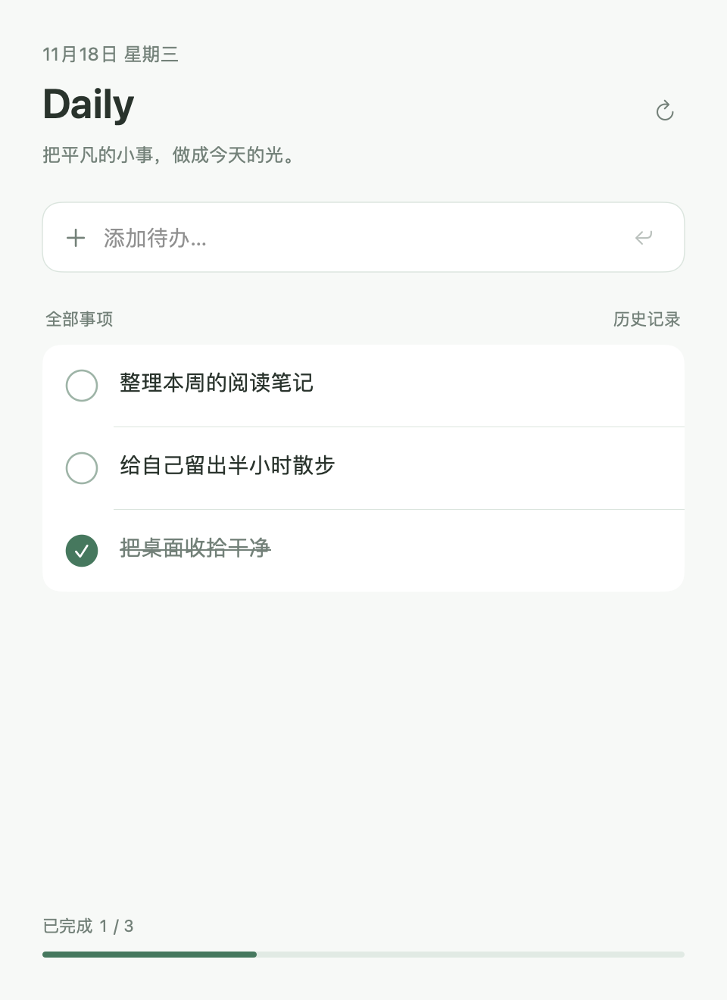
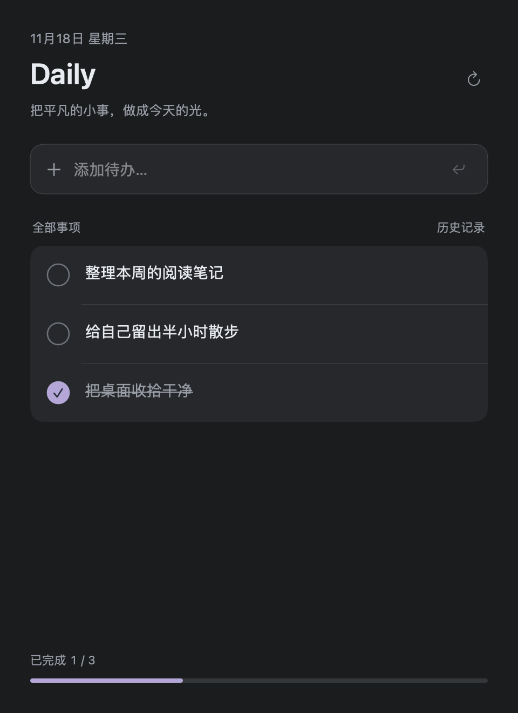

# Daily for macOS

原生 SwiftUI 待办应用，支持 macOS 13 及以上版本，包含 Intel（x86_64）与 Apple Silicon（arm64）架构。

## 界面预览

示例事项为演示数据。

| 日间 | 夜间 |
| --- | --- |
|  |  |

## 下载与安装

从 [macOS v1.6.1 Release](https://github.com/march7th-26/Daily/releases/tag/macos-v1.6.1) 下载：

- `Daily-macOS-1.6.1.pkg`：安装到 `/Applications/Daily.app`，后续在固定位置覆盖更新。
- `Daily-macOS-1.6.1.zip`：解压后，将 `Daily.app` 拖入“应用程序”。

更新前先退出 Daily。待办保存在应用之外，替换应用不会清空事项。

当前发行包采用 ad-hoc 本地签名，没有 Developer ID 签名与 Apple 公证。macOS 可能阻止首次打开；确认来源后，可使用“系统设置 → 隐私与安全性”中的“仍要打开”。安装包无需 Xcode，只有从源码构建才需要。

## 功能

- 输入待办后按回车添加；点击圆圈完成或取消完成，点击 × 删除。
- 所有事项持续保留，包括已完成项；跨天不会清空。
- 一言位于 Daily 标题下方，按天获取文学、诗词或哲学类短句；断网保留缓存或默认句子。
- 日间白绿、夜间深灰配紫色，自动跟随系统外观。
- 窗口最小内容尺寸 280 × 320，可自由拉宽、拉高；小窗口自动收紧布局。
- 菜单栏面板可切换主窗口置顶；主窗口位置与尺寸由 macOS 自动记忆。
- 点击铅笔或双击待办文字进入编辑；Enter 或切换焦点时保存，Esc 取消。可将事项归档到历史记录，再恢复或删除。
- 每天自动检查 GitHub 上的 macOS 正式版更新，点击更新提示会下载 PKG、校验 SHA-256 并打开 macOS 安装器；安装器仍需用户确认，更新包安装到 `/Applications/Daily.app`。建议将应用放在“应用程序”文件夹后使用更新功能。
- 按 Command+N 打开 Daily 主窗口。
- 底部显示完成数量与进度条。
- 菜单栏快捷面板可直接添加和勾选。
- 通知中心提供小号、中号小组件。在 macOS 13 上点击小组件打开应用，再完成操作。

点击屏幕右上角日期时间 → “编辑小组件” → 搜索 **Daily** 并添加。系统控制组件刷新频率，主应用保存后会请求刷新。升级后仍显示旧画面时，可移除并重新添加组件。

## 数据与网络

待办仅保存在本机 App Group 容器：

```text
~/Library/Group Containers/group.com.example.Daylight/todos.json
```

如需备份，先退出应用，再复制该文件。源码沿用最初 macOS 版本的 Bundle ID `com.example.Daylight` 和共享组标识，以保留已有用户的数据与组件关联。

一言请求使用 [一言公开 HTTPS 接口](https://developer.hitokoto.cn/sentence/)，不上传待办内容。句子与作者按接口响应显示，第三方内容与可用性由服务方提供。

## 从源码构建

需要完整 Xcode。当前版本已使用 **Xcode 15.2、Intel Mac、macOS 13.7.8** 编译与运行；Apple Silicon 为交叉编译，尚未进行真机测试。

```bash
cd macos
./build.sh
```

脚本构建双架构应用、进行本地签名验证，并在 `macos/dist/` 输出 PKG、ZIP 和 `SHA256SUMS.txt`。不要将构建目录、用户待办数据或签名凭据提交到仓库。

也可打开 `Daylight.xcodeproj`，选择 **Daylight** scheme 构建。内部工程名沿用初始名称，应用显示为 **Daily**。

若要以自己的开发团队正式签名和公证，应在两个 target 中配置同一团队和获批的 App Group，并同步调整 entitlements 与 `Shared/TaskStore.swift` 的共享组标识。改变共享组将改变数据位置，需要自行迁移已有数据；正式分发前需验证通知中心组件。主应用需要保留 Network Client 权限以访问一言。

## 与 Windows 版的区别

两端独立实现、独立保存数据，目前没有跨设备同步。Windows 版支持托盘直接控制、贴边收纳和自动替换更新；macOS 版提供菜单栏面板、窗口置顶、历史记录、小组件和 GitHub Release 安装包更新流程。macOS 系统安装权限由用户确认。

## 发布流程

`.github/workflows/macos-release.yml` 在推送 `macos-v*` 标签时构建应用，并发布 PKG、ZIP 与校验值。标签版本必须与两个 target 的 Info.plist 版本一致。macOS Release 不设为 Latest，保留 Windows 的现有下载入口。

发布前请更新版本号和 `macos/RELEASE_NOTES.md`，并在支持的系统上检查。构建默认使用本地临时签名，不会自动获得 Apple 公证。
